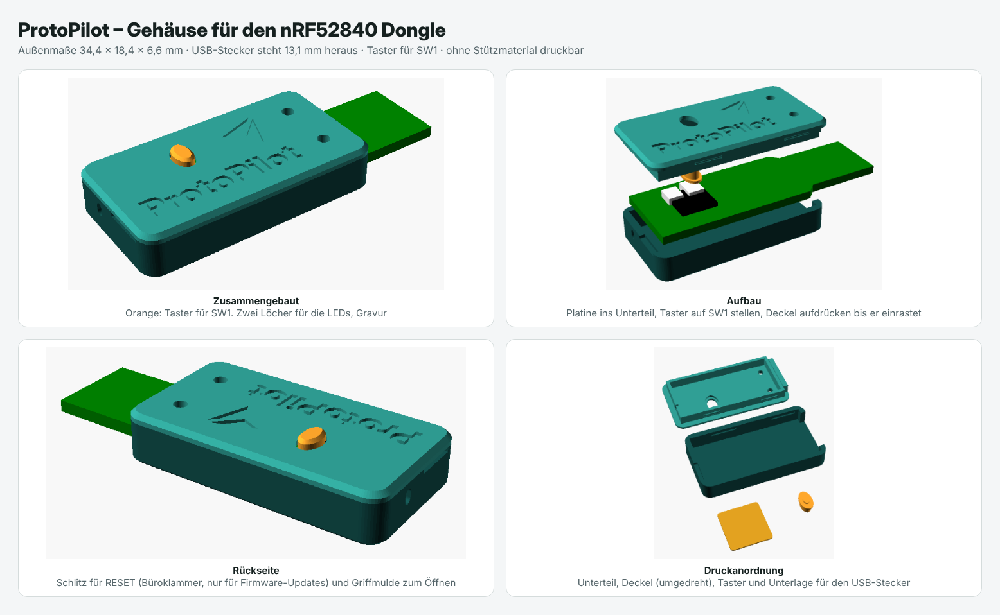

# Gehäuse für den ProtoPilot-Stick

3D-druckbares Gehäuse für den **Nordic nRF52840 Dongle (PCA10059)**. Für den Makerdiary-Stick passt es nicht.



| Datei | Inhalt |
|---|---|
| `stl/protopilot-unterteil.stl` | Wanne, in die die Platine gelegt wird |
| `stl/protopilot-deckel.stl` | Deckel mit Gravur, schon umgedreht zum Drucken |
| `stl/protopilot-taster.stl` | Taster für SW1 (am besten in Signal-Orange) |
| `stl/protopilot-unterlage.stl` | 0,4 mm dünne Unterlage für den USB-Stecker (nur bei Bedarf) |
| `protopilot-gehaeuse.scad` | Quelle zum Anpassen in [OpenSCAD](https://openscad.org) |

Außenmaße 34,4 × 18,4 × 6,6 mm. Der USB-Stecker steht 13,1 mm heraus.

## Vor dem ersten Druck

Die Maße der Platine stammen aus der Zeichnung im Nordic User Guide, über das genormte USB-Maß (12,0 mm) umgerechnet. Am echten Stick sind sie noch nicht geprüft. Deshalb:

1. Einen Stick mit dem Messschieber nachmessen: **Dicke** der Platine, Breite (soll 15,2 mm sein), Länge (soll 45,9 mm sein) und wie hoch die **Kappe von SW1** über der Platine steht (angenommen 1,5 mm).
2. Weicht etwas ab, in OpenSCAD unter *Fenster → Customizer* die Werte bei „Platine – nachmessen!“ ändern, mit F6 berechnen und als STL exportieren. Dasselbe gilt, wenn das Gehäuse zu stramm oder zu locker ist (Wert „spiel“).
3. Erst **ein** Gehäuse drucken und testen, dann die Serie.
4. Am Toughpad prüfen, ob der Stick mit Gehäuse ganz in den USB-Anschluss passt (Abdeckklappe, Rand des Gehäuses).

## Drucken

- **Material: PETG** (oder ASA). PLA wird im Fahrzeug im Sommer weich.
- Düse 0,4 mm, Schichthöhe 0,2 mm (Deckel mit 0,12 mm wird die Schrift schöner), 3 Wandlinien, **ohne Stützmaterial**.
- Unterteil mit dem Boden nach unten, Deckel mit der Oberseite nach unten, Taster mit dem runden Ende nach unten (so liegen die STL-Dateien schon). Den kleinen Taster langsam drucken oder zusammen mit den anderen Teilen, damit jede Schicht abkühlen kann.
- **Zweifarbige Schrift:** Beim Deckel nach 0,4 mm (bei 0,2 mm Schichthöhe nach der 2. Schicht) das Filament wechseln. Logo und Schrift erscheinen dann in der zweiten Farbe.

## Zusammenbauen

1. **Zuerst die Firmware aufspielen** (siehe Haupt-README, Abschnitt Nordic-Dongle).
2. Platine mit den Bauteilen nach oben ins Unterteil legen, der USB-Stecker zeigt durch die Öffnung.
3. Den Taster mit dem kleinen Fuß nach unten auf SW1 stellen, die lange Seite quer zum Stick.
4. Deckel so aufsetzen, dass der Taster durch sein Loch kommt, und an beiden Längsseiten andrücken, bis er einrastet.
5. Wackelt der Stick im USB-Anschluss: die Unterlage mit dünnem doppelseitigem Klebeband unter den USB-Stecker kleben (Unterseite, ohne Kontakte).
6. Öffnen: an der Griffmulde auf der Rückseite mit dem Fingernagel oder einem kleinen Schraubendreher aufhebeln.

## Bedienung im Gehäuse

- **Taster SW1** (kurz = Kopplungsfenster neu öffnen, 5 s halten = Kopplungen löschen): der orange Taster auf dem Deckel.
  - Er liegt lose auf SW1 und wird vom Gehäuse nie nach unten gedrückt. Ein Kragen unter dem Deckel hält ihn fest, darüber sind 0,8 mm Luft. So kann er SW1 nicht dauerhaft drücken, auch wenn SW1 etwas höher ist als angenommen (bis 2,3 mm).
  - Steht der Taster zu weit heraus oder zu wenig: in OpenSCAD `sw1_kappe` auf den gemessenen Wert setzen, die Länge passt sich an. Ist SW1 zu hoch, meldet OpenSCAD eine Warnung.
  - Ohne Taster: `sw1_taster = false`, dann gibt es wie vorher nur ein Loch für die Büroklammer.
- **LEDs:** leuchten durch die zwei kleinen Löcher neben dem USB-Stecker.
- **RESET** (nur für Firmware-Updates): Büroklammer gerade in den Schlitz auf der Rückseite schieben und leicht drücken, die LED pulsiert dann rot. Die genaue Höhe des seitlichen Tasters ist aus der Zeichnung nicht ablesbar, deshalb ist der Schlitz etwas höher. Klappt es nicht, das Gehäuse zum Update öffnen.

## Neu erzeugen

```
openscad -o stl/protopilot-unterteil.stl -D 'teil="unterteil"' protopilot-gehaeuse.scad
openscad -o stl/protopilot-deckel.stl    -D 'teil="deckel"'    protopilot-gehaeuse.scad
openscad -o stl/protopilot-taster.stl    -D 'teil="taster"'    protopilot-gehaeuse.scad
openscad -o stl/protopilot-unterlage.stl -D 'teil="unterlage"' protopilot-gehaeuse.scad
```

Die Gravur nutzt die Schrift Inter Display ExtraBold (frei, rsms.me/inter). Ist sie nicht installiert, nimmt OpenSCAD eine andere Schrift.
